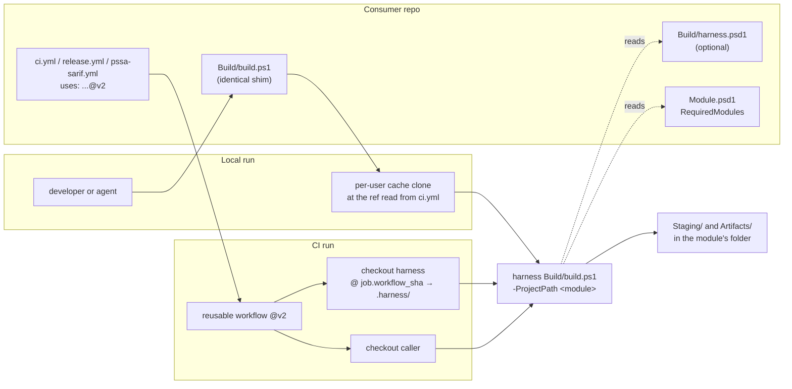

# Centralized build harness — design

- **Requirements:** [requirements.md](requirements.md), approved 2026-11-09
- **Status:** Approved — 2026-11-09. The seven open questions from the requirements are decided below under *Decisions*; the sections before it are the design that results.

## Approach

- `v2.0.0` of this repo carries the build harness under `Build/`: one converged copy of the four files the consumers vendor today, with the corrections #20 found stranded in one or two repos.
- The three reusable workflows check out the caller's repo, as now, and this repo at `job.workflow_sha` into `.harness/`, then run `.harness/Build/build.ps1 -ProjectPath $GITHUB_WORKSPACE`. Harness and workflow cannot drift apart: they are the same commit.
- Each consumer keeps an identical `Build/build.ps1` shim for local runs (Q1), an optional `Build/harness.psd1` for genuine per-repo settings, and its callers pointed at `@v2` (Q5).
- Everything a repo needs to say about itself lives in one of three places: its manifest (runtime modules, Q2), `harness.psd1` (build behaviour that must reach local runs), or its caller YAML (the CI matrix).

## Architecture



### Interfaces

| Interface | Shape |
| --------- | ----- |
| Harness entry point | `Build/build.ps1 -ProjectPath <path> [-TaskList <string[]>] [-Parameters <hashtable>] [-Properties <hashtable>] [-ResolveDependency]`; the same parameters as today plus `-ProjectPath` |
| Task names | the nine existing tasks, unchanged, so the commands in consumers' AGENTS.md keep working |
| Environment variables | both `$env:BH*` and `$env:HARNESS_*` (criterion 4) |
| `Build/harness.psd1` | **optional.** `PSScriptAnalyzerExcludeRules` (string array), `PesterExcludeTag` (string array), `PesterStrictMode` (boolean). A repo with no genuine difference has no file. An unknown key fails the build, so a typo cannot silently disable a setting |
| `ci.yml` inputs | unchanged: `os-matrix`, `min-tests` |
| `release.yml` inputs | `artifact-name`, unchanged; new `dry-run` (boolean, default `false`) |
| `pssa-sarif.yml` inputs | `psscriptanalyzer-settings-path` removed; the harness's settings are used instead (Q3) |
| Job names | unchanged: `normalize matrix`, `validate (<os>)`, `release`, `PSScriptAnalyzer` |

**Required checks do not change.** Every consumer's caller job keys are `validate`, `release` and `analyze` in all seven repos (measured 2026-11-09), and the reusable workflows' job names stay the same, so repointing `@v1` to `@v2` keeps every check name, and no ruleset needs editing.

## Affected files

### This repo

| Path | Change |
| ---- | ------ |
| `Build/build.ps1` | new: harness entry point, taking `-ProjectPath` |
| `Build/build.psake.ps1` | new: the converged tasks, with the stranded fixes, strict mode (Q7) and the single test-selection rule (Q4). Staging copies `Public`, `Private`, `README.md` and the module's `.psd1` and `.psm1`, the set common to all seven; PS.Log's extra `Documentation` path is not carried, because #20 found it stale PlatyPS output that nothing regenerates |
| `Build/depend.psd1` | new: build tools only, pinned (Q2, Q6) |
| `Build/PSScriptAnalyzerSettings.psd1` | new: the shared settings, with **no** `ExcludeRules`. The five excludes carried across the seven repos today (`PSAvoidGlobalVars`, `PSAvoidUsingConvertToSecureStringWithPlainText`, `PSUseShouldProcessForStateChangingFunctions`, and AWSAutomation's two, which move to its `harness.psd1`) are not carried into the shared file: #20 measured on 2026-11-05 that the first three suppress nothing in any repo. C5 contradicted that for PS.SSL under the whole-repo scan `pssa-sarif.yml` runs: `PSAvoidUsingConvertToSecureStringWithPlainText` fires twice in its test fixtures (2026-11-10). Those are suppressed inline in the two test files rather than repo-wide, so the rule stays on for module code |
| `templates/Build/build.ps1` | new: the reference copy of the consumer shim, which the drift check compares against |
| `templates/Build/harness.psd1` | new: an annotated **optional** sample. Its header states that the file is optional and that a repo needing none of its settings should not have one; every key is commented out, with its type, default and the repo that uses it |
| `.github/workflows/ci.yml`, `release.yml`, `pssa-sarif.yml` | harness checkout and invocation; `release.yml` gains `dry-run`; `pssa-sarif.yml` uses the harness settings |
| `.github/workflows/self-test.yml` | adds a `windows-latest` leg |
| `tests/` | new suites for the harness (dependencies, selection, strict mode, `harness.psd1` validation) and the shim |
| `docs/adr/0006-*` | to Accepted, citing the spikes; its "workflow inputs only" decision amended for the shim and `harness.psd1` |
| `docs/adr/0002-*` | amended with the major-version exception (Q5) |
| `docs/dependency-stack.md` | build tools now pinned centrally; runtime modules from the manifest |
| `docs/test-integrity.md` | the three durable rules #20 asks to extract before it closes |
| `docs/shared-ci-standards.md` | deleted; its own header says to delete it when #20 lands |
| `README.md`, `AGENTS.md` | `v2` usage, `harness.psd1`, two major tags (`v1` and `v2`), layout |

### Each consumer, in its migration PR

- Replace `Build/build.ps1` with the shim; delete `build.psake.ps1`, `depend.psd1` and `PSScriptAnalyzerSettings.psd1`.
- Add `Build/harness.psd1` only where needed, starting from the template: AWSAutomation (`PSScriptAnalyzerExcludeRules`), PS.SSL (`PesterExcludeTag`). The other five have none. PS.DCU was to set `PesterStrictMode`; F4 measured that its tests never ran strict under `v1`, so it migrates without it and turns strict tests on separately in [PS.DCU#23](https://github.com/jjohns-dev/PS.DCU/issues/23).
- Repoint all three callers to `@v2`, and drop any `psscriptanalyzer-settings-path` input. The `release.yml` caller also gains a `pull_request` trigger, passing `dry-run: ${{ github.event_name == 'pull_request' }}`, so the migration PR runs the release path from its own branch without publishing. (`workflow_dispatch` cannot do this: GitHub only dispatches a workflow that is already on the default branch.)
- Rename test files to lowercase: PS.SSL 22, PS.DCU 3 (Q4).
- Remove the runtime entries from `depend.psd1` along with the file; the manifest already lists them (Q2).
- PS.DCU's dev container keeps its `postCreateCommand`, which calls the shim. Whether its image (`mcr.microsoft.com/powershell:latest`) includes `git` is **not verified**, and is checked in that PR.
- Close any Dependabot `@v1` → `@v2` PR.

## Alternatives considered

The per-question alternatives are under each decision. At the level of the whole approach:

- **Sampler (#19).** Deferred, not rejected. ADR-0006 records what Sampler's defaults lack and the per-repo layout change it would require.
- **[psake/PowerShellBuild](https://github.com/psake/PowerShellBuild)** (added 2026-11-10, after the design was approved). The closest match: shared psake tasks distributed as a module (`task Build -FromModule PowerShellBuild`), tuned per repo through `$PSBPreference`, much as `harness.psd1` does here. Not adopted: its README says it is a work in progress and not to base critical processes on it (0.8.2, read 2026-11-10); its `Initialize-PSBuild` calls BuildHelpers' `Set-BuildEnvironment`, which this rollout removed, and its README documents a Windows hang that comes from BuildHelpers. Its tasks would replace only the commodity part (stage, analyse, test); the result verification, executed-count floors, per-leg scopes and self-checkout live in the workflows and would remain ours.
- **[PSModule/Process-PSModule](https://github.com/PSModule/Process-PSModule)** (added 2026-11-10). A complete reusable GitHub Actions pipeline that builds, tests, versions, documents and publishes to the PowerShell Gallery. Not adopted: it brings its own conventions for versioning, documentation and publishing, where these repos keep their layout and `release.yml` publishes GitHub releases, not Gallery packages. Whether its required repo structure fits these repos was not checked.
- **Publish the harness as a PowerShell module** (#20's second option). Rejected: it adds a publishing pipeline and Gallery versioning, and it separates the harness version from the workflow version, losing the `job.workflow_sha` guarantee.
- **Keep a canonical copy here and sync it to consumers with automated PRs** (#20's first option). Rejected: it automates the N copies and N PRs rather than removing them.
- **Carry the `harness.psd1` settings in the module manifest** (considered 2026-11-10). Rejected. A top-level key makes `Test-ModuleManifest` and `Import-Module` fail ("manifest contains one or more members that are not valid"), measured on PowerShell 7.6.9. Under `PrivateData` the settings load, but they would ship in every release and appear in `(Get-Module).PrivateData`, and a build-only change would alter the shipped manifest. `RequiredModules` stays in the manifest because users' installs read it; these three settings mean nothing outside the build.

## Risks and tradeoffs

Reviewed against the six Well-Architected pillars.

- **Reliability: blast radius grows.** A bad harness commit reaches every migrated consumer through the moving `v2` tag. That is today's `v1` risk, over more code. *Mitigations:* the required self-test on Linux and Windows; immutable `v2.x.y` tags, so a consumer can pin while a fix lands; the migration order, easiest repos first. *Accepted.*
- **Operational Excellence: failures move away from the repo being built.** A failing build is no longer explained by files in that repo, which ADR-0006 already records. *Mitigations:* the harness prints its own commit SHA and every resolved module version at the start of a run; its error messages name the harness path.
- **Operational Excellence: two major lines during the migration.** Fixes for unmigrated repos come from a `v1` maintenance branch until the last repo moves. *Mitigation:* run the seven migrations back to back.
- **Security: floating runtime modules.** A compromised or broken Gallery release reaches the next build. This is the deliberate trade for staying off stale and vulnerable releases (Q2), and the resolved-version log is the record. The shim runs harness code fetched from this repo at a moving tag, which is the same trust consumers already give `@v1` in CI. No new tokens or secrets are introduced; the harness checkout uses the default `GITHUB_TOKEN` against public repos.
- **Security, in process: Dependabot `@v2` PRs** in unmigrated repos would half-migrate them if merged. *Mitigation:* close them (Q5).
- **Performance Efficiency:** one extra checkout per job. Not measured; expected to be small next to dependency installs.
- **Cost Optimization:** the added Windows self-test leg. Negligible; Actions minutes are free on public repos.
- **Sustainability:** not applicable; no change to infrastructure footprint.
- **Platform:** GitHub Enterprise Server stays excluded while this stands, since `job.workflow_*` is unavailable there (ADR-0006).

## ADR check

- **ADR-0006 moves to Accepted**, citing the self-checkout spike (run [42090065876](https://github.com/jjohns-dev/PS.Log/actions/runs/42090065876)) and the 2026-11-09 shim spike, and amends its Decision: per-repo variation lives in `harness.psd1` and the manifest, not only in workflow inputs, because settings that change the build must also reach local runs.
- **ADR-0002 is amended** with the major-version exception (Q5), by a new ADR-0007.
- **A new ADR-0008: runtime modules float from the manifest; build tools are pinned centrally.** This is a fleet-wide dependency policy that outlives this spec, and it generalises a rule AWSAutomation records only for itself (its own ADR-0002).
- **Feature-local, not ADRs:** strict mode (Q7), the lowercase test-file convention (Q4; recorded in AGENTS.md conventions), and the shim's internals.

## Decisions

### Q1 — Local builds: a per-repo shim (decided 2026-11-09)

#### Decision

- Each consumer keeps one file, `Build/build.ps1`, **byte-identical across the fleet**. It is a shim, not a harness: it locates the harness version the repo's CI uses, makes it available locally, and hands off.
- The shim reads the version from the repo's own caller, the `jjohns-dev/pwsh-module-ci/.github/workflows/ci.yml@<ref>` line in `.github/workflows/ci.yml`. Local runs therefore use the same harness version as CI, with no second pin to maintain.
- It keeps a clone of this repo in a per-user cache, fetches with `--tags --force`, checks out `<ref>`, and calls the harness's `Build/build.ps1 -ProjectPath <module root> @args`.
- It declares no parameters. Everything is forwarded with `@args`, so a new harness task or parameter never changes the shim.
- **CI never runs the shim.** The reusable workflows check out the harness themselves (`job.workflow_sha`), so a broken shim can break a local run but cannot affect a CI result.
- Genuine per-repo settings live beside the shim in an optional `Build/harness.psd1`; what goes in it is decided under Q2 onward.

#### Why

- The consumers' own `AGENTS.md` files tell agents to run `./Build/build.ps1 -TaskList Analyze` / `Test` / `Cleanup` locally (PS.Log, AWSAutomation, SecurityTools; measured 2026-11-09), as does AWSAutomation's `Get-IAMReport.tests.ps1`. The shim keeps that command working unchanged.
- Agents will not check out a matching harness version by hand. Reading the version from the caller gives local–CI parity by construction rather than by discipline.
- Drift is small and detectable. The shim changes only if the repo URL, cache location, version pattern or git commands change; because it is identical everywhere, a byte comparison detects any drift. `build.ps1` had 5 variants when measured on 2026-10-26.

#### Evidence: spike, 2026-11-09, 14 of 14 cases

Run locally in a scratch directory: a bare repo stood in for GitHub, a stub harness recorded what it received, and PS.Log's real `ci.yml` was used for version reading.

- `-TaskList Analyze, Test` arrived as `String[]`, `-Properties @{ PesterScope = 'All' }` as a hashtable, `-ResolveDependency` as a switch, and a positional `Cleanup` bound to `TaskList`. An invalid task was still rejected by the harness's `ValidateSet`.
- The project path resolved to the module root, including when the shim was called by path from another directory.
- Exit codes propagated: 3 in-session, 5 through a child `pwsh`.
- Version reading handled `@v1`, an immutable `@v1.0.0`, and a full SHA with a trailing `# v1.0.0` comment. An unknown ref threw, naming the ref; a missing reference threw.
- After an annotated `v1` was moved to a new commit, the shim ran the new harness.

Not covered by the spike: a real clone from GitHub, a real build through the shim, Windows, and a non-zero exit through `pwsh -File` (a hashtable cannot be passed on that command line).

#### Known traps — the implementation must handle these

- **A failed fetch silently runs a stale harness.** Measured in the spike: with `--force` removed, a moved `v1` was not picked up and the shim ran the old harness with exit 0, no error and no warning. The likely cause, not confirmed, is that the fetch exits non-zero and the shim never checks it. Any fetch failure, including no network, would behave the same way. The shim must check the fetch result and must carry a code comment stating this finding, so that anyone writing a new version of the shim sees it. **On failure it stops** (decided 2026-11-09): continuing from the cache would run a harness version that may not match CI, which is what the shim exists to prevent, and a warning is easily missed by an agent. The cost is that offline local builds fail; an explicit opt-in can be added if that ever matters.
- **CRLF checkouts break a byte comparison.** With `core.autocrlf=true`, the Windows default, a Windows checkout stores the shim with CRLF, and a hash against the reference copy reports drift that is not there. Either normalise line endings before comparing, or pin the shim to LF with `.gitattributes` (`Build/build.ps1 text eol=lf`). Inferred, not measured; the Windows tests below will show which.
- **One shared cache.** If two module repos pin different versions, the cache switches between them on each run. Acceptable for serial use; a cache per ref avoids it if it becomes a problem.

#### Verification

- A Pester suite in `tests/` runs the shim against a fixture module and a local origin, covering every case above in both directions. Include the fetch-failure case, which must stop with a non-zero exit and run nothing.
- `self-test.yml` runs the suites on `ubuntu-latest` **and** `windows-latest`, so Windows behaviour, including the CRLF case, is tested on every change.

#### Accepted without mitigation

- `git` on `PATH`, `pwsh` 7+ rather than Windows PowerShell 5.1, and path separators. These are the user's or agent's responsibility, and the shim does not guard against them.

#### Fallback, kept open: run the harness from a clone of this repo

- No per-repo file. A developer or agent runs `& <path-to-pwsh-module-ci>/Build/build.ps1 -ProjectPath <module> -TaskList Test`, with `-ProjectPath` defaulting to the current directory.
- Costs: AGENTS.md, CONTRIBUTING.md, AWSAutomation's test-file comment and PS.DCU's dev container `postCreateCommand` all change in each repo; matching CI's version means checking out the right tag by hand.
- **Switching is cheap by design.** Criterion 2 already makes `-ProjectPath` an explicit harness input, so both options call the same harness the same way. Switching replaces the shim and changes no harness code.
- **Revisit if:**
  - the shim has to change often enough that keeping it identical becomes a burden;
  - fetching or caching proves unreliable for people or agents;
  - a platform problem appears that the shim cannot handle and the fallback avoids.

### Q2 — Runtime dependencies: read from the manifest, float unless declared (decided 2026-11-09)

#### Decision

- **Names** come from the module manifest's `RequiredModules`, the list PowerShell already enforces at import. The runtime entries in each repo's `depend.psd1` are not carried forward.
- **Versions float by default.** A module the manifest lists without a version is installed at the latest release, by calling `Install-PSResource` with no `-Version`.
- **A specific version is supported, but only when the manifest declares it.** Pinning is a property of the module, so it lives where users' installs see it:

  ```powershell
  RequiredModules = @(
      'AWS.Tools.Common'                                           # floats
      @{ ModuleName = 'ImportExcel'; RequiredVersion = '7.8.10' }  # exact pin, only when declared
  )
  ```

  | Manifest entry | Harness installs |
  | -------------- | ---------------- |
  | `'Name'` | latest |
  | `@{ ModuleName; ModuleVersion }`, a minimum | latest, which satisfies the minimum |
  | `@{ ModuleName; RequiredVersion }` | exactly that version |
  | `@{ ModuleName; MaximumVersion }` | fails with a message naming the module, until a repo needs it |

- **Every build logs each resolved version**, as `Resolved dependency: <name> <version>`. With nothing pinned, that line is the only record of what a build ran against. AWSAutomation and PS.DCU already do this; it is one of the eight stranded fixes from #20 and becomes required here.
- **Build tools stay pinned**, centrally in the harness: Pester, psake and PSScriptAnalyzer. They change test and analysis outcomes, so a new release could turn a build red with no change in the repo. Bumping them stays deliberate; which PSScriptAnalyzer version is Q6.
- **`Build/harness.psd1` does not carry dependencies.** It holds only settings that change what the build does and have no other home.

#### Why

- Floating keeps every module off stale releases, including ones carrying known bugs or vulnerabilities. SecurityTools' `ImportExcel = '7.8.10'` was the latest release when written, not a deliberate pin.
- The manifest is what users get. A pin held only in a harness setting would make CI test against one version while users install whatever the manifest allows.
- One list, not two. Today the names in `depend.psd1` and the manifest are kept in step by hand.
- Omitting `-Version` is the only reliable way to get the latest: a NuGet range resolves to an arbitrary member under PSResourceGet 1.2.0 (`docs/dependency-stack.md`). This is also why `MaximumVersion` fails rather than being guessed.

#### Evidence: measured 2026-11-09 against each repo's `main`

| Repo | Runtime entries in `depend.psd1` | Manifest `RequiredModules` |
| ---- | -------------------------------- | -------------------------- |
| PS.Log, PS.GHOps, PS.GitHub, PS.SSL, PS.DCU | none | none; commented out in PS.Log, PS.SSL and PS.DCU |
| AWSAutomation | 15, all `latest`: `ImportExcel` and 14 `AWS.Tools.*` | the same 15 names, unversioned |
| SecurityTools | `ImportExcel = '7.8.10'` | `ImportExcel`, unversioned |

The names match exactly in both repos that have any, so reading them from the manifest installs the same set. No manifest declares a version today.

#### Consequences

- SecurityTools' CI moves from `ImportExcel` `7.8.10` to the current release. Its executed counts are checked against the baseline like every other change (criterion 5).
- Adding a dependency to a manifest is enough for CI and local builds to install it. Forgetting to add it to a second list is no longer possible.
- A floated release can still break a build overnight. That is the accepted trade, and the resolved-version log is what diagnoses it.

#### Verification

- Pester cases for each manifest form in the table, including the `MaximumVersion` failure, a manifest with no `RequiredModules`, and one with the key commented out.
- A case proving an unversioned entry is installed without `-Version`, and one proving the resolved-version line is emitted for every module.

### Q3 — Workflow scope: all three move together (decided 2026-11-09)

#### Decision

- **One harness release covers `ci.yml`, `release.yml` and `pssa-sarif.yml`**, behind the opt-in chosen under Q5. Work in this repo can land in steps, but nothing reaches a consumer until all three are ready.
- **Each consumer switches all three callers in one PR**, and in the same PR deletes `Build/` except the shim and any `Build/harness.psd1`.
- **`pssa-sarif.yml` uses the harness's analyzer settings**, the central settings file plus the repo's `ExcludeRules` from `harness.psd1`, so the Security tab and the build gate apply the same rules.
- **`release.yml` gains a dry-run mode** that builds and uploads the artifact but skips publishing the release. Each consumer's release caller gains a `pull_request` trigger that passes `dry-run: true` on pull requests, so the migration PR runs the release path from its own branch and compares the artifact's contents with the repo's last real release before merging. It keeps running on every later PR, so the release path stops being exercised only at release time. A `workflow_dispatch` trigger was considered and rejected: GitHub only dispatches a workflow that is already on the default branch, so it could not run from the migration PR ([source](https://docs.github.com/en/actions/how-tos/manage-workflow-runs/manually-run-a-workflow)).

#### Why

What each workflow takes from the consumer's `Build/` today, read from the workflow files on 2026-11-09:

| Workflow | Uses |
| -------- | ---- |
| `ci.yml` | `./Build/build.ps1` for `Init`, `CombineFunctionsAndStage`, `Analyze`, `Test` |
| `release.yml` | the same four, plus `CreateBuildArtifact` |
| `pssa-sarif.yml` | `./Build/PSScriptAnalyzerSettings.psd1`, the default of its settings-path input |

Moving `ci.yml` alone does not work for any consumer:

- Once a consumer adopts the shim, its `Build/build.ps1` *is* the shim, so an unmigrated `release.yml` would run the shim in CI. That breaks Q1's guarantee that CI never runs the shim, and the shim would fetch the harness version named in `ci.yml` rather than in `release.yml`, which differ whenever the callers are not repointed together.
- `build.psake.ps1`, `depend.psd1` and the settings file could not be deleted while `release.yml` still used them.
- `pssa-sarif.yml` would fail once the settings file was deleted.

The dry run exists because the release path is almost never exercised. `release.yml` runs only on a consumer's version-tag push, which is why the `action-gh-release` bump in `v1.6.1` is still unconfirmed. Without it, a harness change to `CreateBuildArtifact`, including the `PS.DCU` dependency question in criterion 8, would first run on someone's real release.

#### Consequences

- A consumer's migration PR touches three caller files and deletes up to three `Build/` files. It is larger than a one-workflow change, but it leaves the repo in one consistent state, never half-migrated.
- `pssa-sarif.yml` needs the harness checkout, as `ci.yml` and `release.yml` do.
- The Security tab still analyses the whole repo, while the build gate analyses `Staging/`. That difference is pre-existing and out of scope; this decision only stops the *rules* from differing too.
- **PS.DCU's `CreateBuildArtifact` dependency was measured and rejected** (task B9, 2026-11-09). Declaring `-depends 'Init', 'CombineFunctionsAndStage'` pulls in `Setup`, which deletes `Artifacts/`; run after `Test`, as `release.yml` does, it destroyed the Pester result file. The harness keeps `-depends 'Init'`, and `tests/HarnessTasks.Tests.ps1` fails if the result file does not survive.

#### Verification

- Each consumer's migration PR shows all three workflows green on the harness, plus a dry-run release whose artifact matches its last real release file for file, except for differences the design causes on purpose and the PR names. Known so far: PS.Log's artifact no longer contains `Documentation/`.

### Q4 — Test selection: one rule, default `All` (decided 2026-11-09)

#### Decision

- **The harness adopts SecurityTools' three scopes**, resolved inside the `Test` task rather than in `Properties`, so a `-Properties` override takes effect:

  | Scope | Selects |
  | ----- | ------- |
  | `All`, the default | every cross-platform test file, plus Windows-only files when running on Windows |
  | `CrossPlatform` | cross-platform files only |
  | `WindowsOnly` | Windows-only files only |

- **A Windows-only file is one whose name ends `.tests.windows.ps1`.** Matching ignores case: the harness lists `.ps1` files and tests each name with `-match`, rather than relying on a wildcard pattern whose case handling on Linux is unverified.
- **The search depth stays at `Tests/*/`**, one folder below `Tests/`, as PS.SSL and SecurityTools use today, so the harness picks up exactly the files those repos run now. The other five repos' patterns were not read for this decision; the baseline counts show any difference.
- **The scope reaches the harness the way it does today:** per leg through `os-matrix` in CI, and `-Properties @{ PesterScope = ... }` locally. No `harness.psd1` entry is needed for selection.
- **Pester tag exclusion goes in `Build/harness.psd1`** as `PesterExcludeTag`. PS.SSL is the only repo that needs it (`'Network'`), and it has to apply to local runs as well as CI.
- **Test files are named in lowercase, `*.tests.ps1` and `*.tests.windows.ps1`, fleet-wide.** Each repo renames during its own migration PR. The harness ignores case either way, so this is a consistency rule, not a functional one.

#### Why

Measured 2026-11-09 against each repo's `main`:

| Repo | Cross-platform files | Windows-only files | How it selects today |
| ---- | -------------------- | ------------------ | -------------------- |
| PS.SSL | 21 | 1, `Loader.Tests.windows.ps1` | in `Properties`: cross-platform always, plus Windows-only `if ($IsWindows)` |
| SecurityTools | 65 | 9, `*.tests.windows.ps1` | in the `Test` task: `$PesterScope`, default `All` |
| PS.Log, PS.GHOps, PS.GitHub, PS.DCU, AWSAutomation | 3–11 each | 0 | every file |

- PS.SSL's own comment says its Windows tests "follow the SecurityTools pattern", and SecurityTools' `All` selects exactly what PS.SSL selects on each OS. One rule therefore reproduces both, with no setting in PS.SSL.
- For the five repos with no Windows-only files, `All` is every test file, as today.
- SecurityTools already passes `CrossPlatform` and `WindowsOnly` per leg since #21, so nothing changes for it.
- Resolving the scope inside the `Test` task follows SecurityTools' documented reason: in `Properties` a `-Properties` override would not take effect.

File-name casing, measured the same day, counting both suffixes:

| Repo | `.Tests` | `.tests` |
| ---- | -------- | -------- |
| PS.GHOps | 0 | 11 |
| PS.GitHub | 0 | 8 |
| SecurityTools | 3 | 71 |
| AWSAutomation | 3 | 8 |
| PS.Log | 3 | 6 |
| PS.SSL | 22 | 0 |
| PS.DCU | 3 | 0 |

Lowercase is the majority, 104 files to 37. PS.SSL and PS.DCU are entirely `.Tests`, so renaming only PS.SSL's Windows file would have left PS.SSL internally inconsistent. The `3` in PS.Log, AWSAutomation and SecurityTools is probably the `Tests/Common/` files, which #53 centralises; not confirmed by name.

#### Consequences

- PS.SSL renames all 22 test files, including `Loader.Tests.windows.ps1` → `Loader.tests.windows.ps1`, and PS.DCU its 3, each in its migration PR. Files that land in `Tests/Common/` follow whatever #53 ships.
- **Use `git mv` for each rename, and confirm with `git status` that git records it as a rename.** On a case-insensitive file system, the macOS default, a rename that only changes case can fail to register otherwise. Believed handled by modern git; not verified.
- PS.SSL's selection moves from `Properties` into the `Test` task, so a `-Properties @{ PesterScope = ... }` override starts working there too.

#### Verification

- Pester cases for each scope on each OS, including mixed-case names (`.Tests.windows.ps1` and `.tests.windows.ps1`) and an unknown scope, which must fail.
- Executed counts after migration must equal the baseline: PS.SSL 346 on Ubuntu and 347 on Windows, SecurityTools 996 and 21, and every other repo unchanged. A file picked up or missed at the wrong depth shows here. Renames do not change which tests run, so the counts also confirm no file was lost in a rename.

### Q5 — Opt-in: the central harness ships as `v2` (decided 2026-11-09)

#### Decision

- **The central harness is released as `v2.0.0`, with a new moving `v2` tag.** `v1` never moves onto it.
- **A consumer opts in by repointing all three callers from `@v1` to `@v2`** in its migration PR (Q3). There is no input switch and no interim exact-version pin.
- **`v1` stays on `v1.6.x` for unmigrated consumers.** An urgent fix for them is cut as `v1.6.x` from a branch off `v1.6.1`, because `main` carries `v2`. Once the last consumer has moved, `v1` is retired: no further releases.
- **Migration order, easiest first**, so early PRs prove the mechanism before the hard cases:

  | Order | Repo | What it exercises |
  | ----- | ---- | ----------------- |
  | 1 | PS.GHOps, PS.GitHub | byte-identical `Build/`, no `harness.psd1`, no runtime modules |
  | 2 | PS.Log | the baseline case |
  | 3 | PS.DCU | dev container `postCreateCommand`, `.Tests` renames |
  | 4 | AWSAutomation | `ExcludeRules`, 15 floating runtime modules |
  | 5 | PS.SSL | tag exclusion, 22 renames, Windows-only selection under `All` |
  | 6 | SecurityTools | per-leg scopes, the `ImportExcel` pin dropping |

#### Why

- Moving `v1` to the harness would change unmigrated consumers' outcomes. Their own `Build/` would be ignored, and without a `harness.psd1` PS.SSL would stop excluding its `Network` tests. Criterion 6 forbids that.
- **A major makes the state visible.** `@v2` in a caller means the repo is on the central harness; `@v1` means it still vendors its own. No other record is needed.
- It needs no closing round of repoint PRs. An exact-version pin would have required seven more one-line PRs to move back to `@v1`.
- `v1` never moves onto the harness, so there is no single event that changes all seven repos at once.
- The window in which unmigrated repos need fixes from a maintenance branch is the same as an exact-version pin's would have been.

#### Alternatives rejected

- **An input switch** (`harness: central`) on `@v1`: every workflow carries both code paths during the migration, both need tests, and removing the input afterwards is itself a `v2` under ADR-0002 unless it stays as a no-op forever.
- **An exact-version pin** (`@v1.7.0`), then move `v1` once all seven are on it: the existing staging playbook, but it costs seven repoint PRs and ends in a fleet-wide `v1` move.

#### ADR-0002 exception

ADR-0002 defines "breaking" as the consumer's call no longer working. By that test this change is a minor: the inputs and job names are unchanged. It is released as a major deliberately, and **ADR-0002 is amended to say so** with a narrow rule: *a change that replaces what runs the consumer's build is a major, even when the call still works.* Recording the rule keeps ADR-0002's definition meaningful for every other change.

#### Known risk: Dependabot

- All seven consumers run Dependabot on `github-actions` with no ignore rules, measured 2026-11-09, and GitHub documents that it keeps references to "reusable workflows used inside workflows" up to date ([source](https://docs.github.com/en/code-security/dependabot/working-with-dependabot/keeping-your-actions-up-to-date-with-dependabot)).
- Whether it proposes a `@v1` → `@v2` jump for a reusable workflow is not verified. It does for actions such as `actions/checkout`, so expect it.
- Merging such a PR would put a repo on the harness with its old `Build/` still present and no `harness.psd1`. **Close those PRs**; the migration PR replaces them.

#### Follow-up tasks

- Amend ADR-0002 with the exception above.
- Update AGENTS.md's *Versioning* and *Cutting a release* sections for two moving tags, `v1` and `v2`, and the retirement of `v1`.
- When cutting `v2`, confirm that `protect-release-tags` covers it. AGENTS.md says that ruleset matches `v*` excluding `v*.*.*`, which includes `v2`; that comes from the doc, not from the API.

#### Not portable to `PS-MCS`

`mcssec-ops`' consumers pin `@main`, not a tag, so there is no version to repoint. That org would need an input switch, or verification before merge. Recorded for criterion 11; not solved here.

### Q6 — Build-tool versions: PSScriptAnalyzer 1.25.0, adopted in each migration PR (decided 2026-11-09)

#### Decision

- **The harness pins** Pester `6.2.0`, psake `5.0.4` and PSScriptAnalyzer `1.25.0`, each the latest release on the PowerShell Gallery on 2026-11-09.
- **The five repos on PSScriptAnalyzer `1.24.0` move to `1.25.0` in their own migration PR**, not in a separate round first. Nothing in those repos needs editing for it: the migration deletes their `depend.psd1`, and the harness's pin takes over.

#### Why

| Tool | Latest on the Gallery | Fleet before migration |
| ---- | --------------------- | ---------------------- |
| Pester | 6.2.0 | 6.2.0 everywhere |
| psake | 5.0.4 | 5.0.4 everywhere |
| PSScriptAnalyzer | 1.25.0 | 1.25.0 in PS.Log and AWSAutomation; 1.24.0 in the other five |

- **The risk was measured on #20 on 2026-11-05.** PSScriptAnalyzer 1.25.0 was run against all seven repos' `Public/` and `Private/` with no rules excluded: zero Error-severity findings, and every gate fails only on Errors. The three rules new in 1.25.0 produced no findings at any severity. Caveat: that run analysed the source folders, not `Staging/`.
- **`pssa-sarif.yml` already uses 1.25.0** for all seven, so today the Security tab and five build gates run different analyzer versions. This closes that gap.
- Converging first would take five PRs to edit files the migration then deletes.
- A failure would be contained. If 1.25.0 fails a repo's `Analyze`, it shows in that repo's migration PR and blocks only that PR.

#### Consequences

- A migration PR changes the harness and, for five repos, the analyzer version at once. If `Analyze` fails, run 1.24.0 and 1.25.0 side by side on that repo's `Staging/` to tell which change caused it.
- Later bumps are one change in this repo, released deliberately like any other harness change; the baseline counts guard test behaviour. Dependabot cannot see Gallery pins, so nothing bumps them automatically.

### Q7 — Strict mode: strict harness code, lenient tests by default, opt-in per repo (decided 2026-11-09)

#### Decision

- **The harness's own code runs under `Set-StrictMode -Version Latest`**, set at the **top of `build.psake.ps1`** (measured under B5, below). Setting it in `build.ps1` does not work.
- **Consumer tests run without strict mode by default.** The `Test` task turns strict mode off explicitly around `Invoke-Pester`, so the harness's setting never reaches a consumer's tests.
- **A repo can opt in to strict tests** with `PesterStrictMode = $true` in `Build/harness.psd1`, one repo at a time, after confirming its tests pass under it. PS.DCU is the first candidate ([PS.DCU#23](https://github.com/jjohns-dev/PS.DCU/issues/23)); see the 2026-11-12 correction below.

#### Evidence: measured 2026-11-09, psake 5.0.4 and Pester 6.2.0, each run in a fresh `pwsh`

| `Set-StrictMode -Version Latest` | psake task body reading an undefined variable | Pester test reading an undefined variable or a missing property |
| -------------------------------- | --------------------------------------------- | --------------------------------------------------------------- |
| not set | passes silently, build succeeds | both pass |
| set in the calling script, as PS.DCU's `build.ps1` does | **still passes silently**, build succeeds | **both fail** |

- Strict mode set in `build.ps1` does not reach psake task bodies.
- It does reach the consumer's Pester tests.
- **Contradicted 2026-11-12 for PS.DCU itself.** At `d38c98c`, PS.DCU's real `v1` build passed a probe test that reads an undefined variable, so its tests did not run strict. Why this differs from the row above is not established.

#### Placement, measured 2026-11-09 for task B5 (psake 5.0.4)

The dead-gate expression `($analysisResult.Count -eq 0)` in a task body, with strict mode set in each candidate place:

| Strict mode set | Task body | `build_success` |
| --------------- | --------- | --------------- |
| nowhere (control) | ran to completion | `True` |
| top of `build.psake.ps1` | strict error, task stopped | `False` |
| inside the task | strict error | `False` |
| in `Properties` | strict error | `False` |

All three placements work. The top of the file is chosen because one line covers every task. It also reaches `Invoke-Pester` inside the `Test` task, which is why that task turns strict mode off unless `PesterStrictMode` is set.

#### Correction to #20

The classification on #20 observed that PS.DCU is the only repo running strict mode *and* the only one that fixed the dead `$analysisResult` gate, and inferred, labelled as unproven, that the first explained the second. **The measurement disproves it.** PS.DCU sets strict mode in `build.ps1`, which does not reach the psake task where that gate lives; the same expression still evaluates `True` and the build passes. How PS.DCU's fix was found is unknown.

#### Why

- Strict harness code is what catches the defect class #20 found, such as the dead analysis gate. The harness is this repo's code, so its failures are ours to fix.
- If the harness's strict mode reached `Invoke-Pester`, all seven repos' tests would turn strict at once, and tests that pass today could fail. That would break criterion 5's unchanged counts.
- The opt-in gives the fleet a path to strict tests one repo at a time. *Corrected 2026-11-12:* this bullet said PS.DCU's 85 tests pass under strict mode today. That was never measured and is wrong: under `PesterStrictMode = $true` three `help.tests.ps1` cases fail, and the `v1` build never ran them strict (see the evidence above).

#### Verification

- A Pester case proving the harness's strict mode catches the `$analysisResult` pattern in a task body, and the reverse: the same task without strict mode passes silently.
- A case proving strict mode does not reach a consumer test by default, and a case proving `PesterStrictMode = $true` turns it on.
- PS.DCU's executed count stays at 85 after migration.
