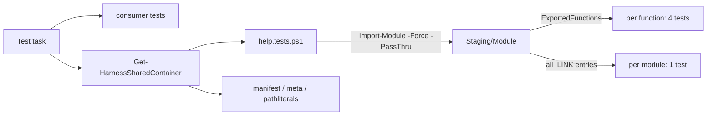

# Shared help suite — design

- **Requirements:** [requirements.md](requirements.md), approved 2026-11-16; AC 2 amended as proposed here
- **Status:** Approved — 2026-11-16

## Approach

One new file, `Build/SharedTests/help.tests.ps1`, picked up by the existing `Get-HarnessSharedContainer` with no harness change: the function already discovers every `*.tests.ps1` in that folder and passes each suite the `-Data` keys its `param` block declares. The suite imports the staged module, as the manifest suite's resolved-exports test does, and reads each exported function's comment-based help from its AST.

Measured 2026-11-16 by staging each consumer's `main` as `CombineFunctionsAndStage` does, importing it under `Set-StrictMode -Version Latest` and running these checks: every function in all eight passes, except the one dynamic-parameter case below.

## Architecture



### Interfaces

- `param ([System.String] $ProjectPath, [System.String] $ModuleName)`, not mandatory and validated in `BeforeAll`/`BeforeDiscovery`, like the other three, so a missing key fails instead of prompting.
- Staged path: `Join-Path $ProjectPath 'Staging' -AdditionalChildPath $ModuleName`, as manifest test 11.

### Discovery and run

- `BeforeDiscovery` imports the staged module with `-Force -PassThru` and passes the exported **names** to `Describe -ForEach`. Names, not `CommandInfo`: `BeforeDiscovery` variables do not reach the run phase, so anything the `It` blocks need travels as `-ForEach` data.
- `BeforeAll` imports again with `-Force -PassThru` and takes each command from the returned module's `ExportedFunctions`, never by name lookup. A consumer test may have removed or replaced the loaded module, and a same-named command elsewhere would otherwise shadow it.
- The help suite sorts first (`help` < `manifest`), so it runs straight after the consumer's tests. Its own import makes order irrelevant.

### The checks (AC 3, AC 4, AC 5)

Help is `$command.ScriptBlock.Ast.GetHelpContent()`. When it is `$null`, each of the four per-function tests fails with *has no comment-based help*.

| Test | Fails when |
| ---- | ---------- |
| `<Name> has a synopsis` | `Synopsis` is null or whitespace |
| `<Name> has a description` | `Description` is null or whitespace |
| `<Name> has an example` | no `Examples` entry with non-whitespace text |
| `<Name> documents exactly its parameters` | a declared parameter, common parameters excepted, has no entry or a whitespace one; or an entry names no declared parameter |
| `has a well-formed URI in every .LINK` (once per module) | any exported function has a `.LINK` URI that does not match `^https?://` or is not `[System.Uri]::IsWellFormedUriString(..., Absolute)` |

- **Both link conditions are needed**, as the Group A comment records: the pattern rejects `ftp://` and `htp:/broken`, which `IsWellFormedUriString` accepts; `IsWellFormedUriString` rejects `https://example.com/a^b`, which the pattern accepts.
- **A `.LINK` is a URI when it starts with a scheme**, `^[A-Za-z][A-Za-z0-9+.-]*:`. `Get-Item` and `about_Foo` are not, and are skipped. A Windows path such as `C:\x` reads as a URI and fails, which is correct for a `.LINK`.
- **Common parameters** come from `[System.Management.Automation.PSCmdlet]::CommonParameters` and `OptionalCommonParameters`, not a hand-kept list.
- **Read dictionary keys through `.PSBase.Keys`.** AWSAutomation's `Get-RoleCredential` has a parameter named `Keys`, so `$command.Parameters.Keys` returns that `ParameterMetadata` instead of the key list. Measured 2026-11-16: the naive form fails that function with nine false findings. PS.DCU's current suite uses the naive form.
- Every failure names the function and the parameter or link, through `-Because` (AC 7).

### Dynamic parameters (AC 2, amended)

AC 2 requires reading parameters "from the imported module so that dynamic parameters are included". That cannot be done in general. A `DynamicParam` block runs only when the command is bound, so neither `$module.ExportedFunctions[...].Parameters` nor `Get-Command` lists a dynamic parameter without arguments. Measured 2026-11-16: neither shows `Get-KEVList -OutputDirectory`, which SecurityTools adds only when `-Format` is bound.

SecurityTools' current suite works around it by re-querying with the first `ValidateSet` value of each parameter. That is a heuristic: it executes the module's `DynamicParam` code with guessed arguments, and covers only the shape it was written for.

**AC 2, as amended:** *THE help suite SHALL check every function the staged module exports. FOR a function with a `DynamicParam` block, a `.PARAMETER` entry naming no static parameter SHALL NOT fail, because its dynamic parameters cannot be listed without binding it.*

- Detected from the AST: `$command.ScriptBlock.Ast.Body.DynamicParamBlock`.
- Cost: an undocumented dynamic parameter, or a stale `.PARAMETER` on a function that has a `DynamicParam` block, goes undetected. One function in the fleet has one (measured 2026-11-16: `Get-KEVList`).
- How other harnesses handle it, checked 2026-11-16: juneb's `Module.Help.Tests.ps1`, which Group A descends from, and PSFramework's `Help.Tests.ps1` read only static `ParameterSets.Parameters`; PSFramework's escape hatch is a per-repo list of commands to skip entirely. Microsoft's documented route is `Get-Command -ArgumentList` with the triggering arguments. This exemption needs no configuration and relaxes one check on one kind of function.

### Future: checking dynamic parameters

Not built now: one function in the fleet has a `DynamicParam` block. If more appear, or one needs its dynamic parameters checked, extend the suite with per-function trigger arguments, the `Get-Command -ArgumentList` route, as an optional `harness.psd1` setting:

```powershell
# Arguments that make a function's DynamicParam block emit its parameters, so the help suite
# can check them like static ones. Hashtable of exported function name to argument array; default none.
# A listed function must be exported and have a DynamicParam block, and its arguments must
# add at least one parameter, or the build stops, so an entry cannot silently go stale.
# HelpDynamicParameterArguments = @{ 'Get-KEVList' = @('CSV') }
```

- `Get-HarnessSetting` validates the key: a hashtable whose values are arrays.
- `Get-HarnessSharedContainer` gains it as an available `-Data` key, and the help suite declares it.
- For a listed function, the suite resolves the command with `Get-Command -Name '<Module>\<Function>' -ArgumentList <values>`, adds the parameters it reports as `IsDynamic` to the declared set, and runs the parameter test with no exemption. Unlisted functions with a `DynamicParam` block keep the AC 2 exemption.
- **Unverified until built:** how `-ArgumentList` binds a function's arguments. SecurityTools' suite passes `ValidateSet` values positionally and finds `-OutputDirectory`; whether named arguments work, and how a parameter with no position is triggered, must be measured first.
- It executes the module's `DynamicParam` code with the configured arguments at test time; a block with side effects would run them.

### Strict mode

The `Test` task turns strict mode off unless a consumer sets `PesterStrictMode`, as PS.DCU does. The suite must pass both ways; the 2026-11-16 measurement ran strict, and `tests/` runs every case both ways (AC 8).

## Test counts

A consumer's shared count goes from `14 + n` to `15 + 5n` for `n` exported functions: `11 + 3 + n`, plus `4n + 1`. Per repo, from the requirements: PS.Log 25, PS.GHOps 41, PS.GitHub 25, PS.SSL 61, PS.DCU 33, AWSAutomation 145, SecurityTools 265, PS.YNAB 37, each counted on every leg that runs the shared suites.

## Affected files

### This repo

| File | Change |
| ---- | ------ |
| `Build/SharedTests/help.tests.ps1` | New |
| `tests/SharedTests.Tests.ps1` | A help entry in the suite table, each case naming the tests it must fail, lenient and strict (AC 8) |
| `tests/Harness.Tests.ps1` | The expected container list gains `help.tests.ps1` |
| `tests/HarnessTasks.Tests.ps1` | The fixture function gains complete help; `$sharedCount` 15 → 20; the suite list gains `help.tests.ps1` |
| `docs/consumer-guide.md` | *Shared tests*: four suites, `15 + 5n`, delete `help.tests.ps1` |
| `docs/test-integrity.md` | Why help is per function with one looped link test; the `.PSBase.Keys` trap; the intro's `Help.Tests.ps1` mention |
| `AGENTS.md` | `Build/` row: four suites |

`Build/Harness.Functions.ps1` and `Build/build.psake.ps1` are unchanged.

Fixture cases, each failing exactly the named tests: complete help (none); no help (all four per-function); empty synopsis; empty description; no example; an undocumented parameter; an empty `.PARAMETER`; a `.PARAMETER` naming no parameter; the same on a function with a `DynamicParam` block (none); a parameter named `Keys`, documented (none); `.LINK` to a command name (none); `.LINK` `https://example.com/ok` (none); `.LINK` `htp:/broken` and `https://example.com/a^b` (link, naming both); two functions, one defective (only its tests).

### Each consumer, in its cleanup PR (AC 11)

- PS.Log, PS.SSL, PS.DCU, AWSAutomation, SecurityTools: delete `Tests/Common/help.tests.ps1`, and `Tests/Common/` if it is then empty; update `AGENTS.md` where it describes that file (PS.DCU line 40 and PS.SSL line 48 do).
- PS.GHOps, PS.GitHub, PS.YNAB: nothing to delete.
- All eight: recalculate every leg's `min-tests` from the PR's own run.

## Rollout (AC 9, AC 10)

1. Ship as `v2.2.0`, a minor: new checks that can turn a build red are not breaking (ADR-0002).
2. Prove on two throwaway PRs pinned `@v2.2.0`: **PS.GHOps**, no help tests and three legs (ubuntu, windows, macOS), expected `+41` per leg; **SecurityTools**, the dynamic parameter, expected `+265` on ubuntu and its windows leg unchanged. Both expected green.
3. Move `v2`. Nothing should turn red: the 2026-11-16 measurement found no defects, and executed counts only rise, so existing floors still hold. The five repos with a `help.tests.ps1` run both suites until cleaned up.
4. One cleanup PR per consumer, through the repo agents as in #53.

## Alternatives considered

- **Per-parameter tests** — rejected in the requirements (Q1).
- **A per-function link test** — rejected in the requirements (Q2).
- **Reading help through `Get-Help`** — rejected by AC 5 for parameters. For links, Group A uses `Get-Help` to tell URIs from command names; the scheme pattern does the same from the AST with one source of truth.
- **SecurityTools' `ValidateSet` trigger for dynamic parameters** — rejected: it executes module code with guessed arguments and covers only one shape.
- **Reading `Public/*.ps1` with the parser instead of importing** — rejected: the exported set is what ships, and AC 2 checks exported functions; the manifest suite already proves the two agree.

## Risks and tradeoffs

- **Fleet-wide at once** (reliability). Every consumer runs the suite when `v2` moves. Mitigated by the zero-defect measurement, the two-repo proof and a one-tag rollback.
- **Dynamic parameters are partly unchecked** (the amendment). Accepted: one function, and the alternative is guessing arguments.
- **A second import of the staged module** (performance). One `-Force` import per discovery and run phase; dependencies are already loaded by `ImportStagingModule`.
- **The suite trusts the AST's help parser.** A help block PowerShell does not associate with its function reads as *no help*. Correct: `Get-Help` would not find it either.

## ADR check

None. This reuses #53's mechanism; the per-function rationale is feature-local and goes in `docs/test-integrity.md`.
